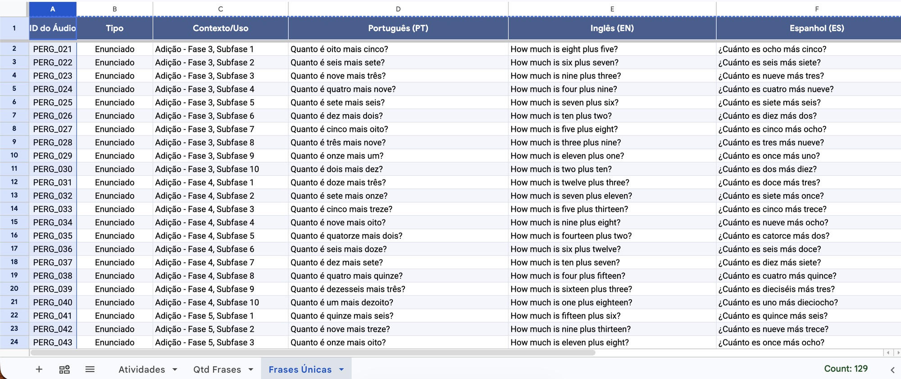
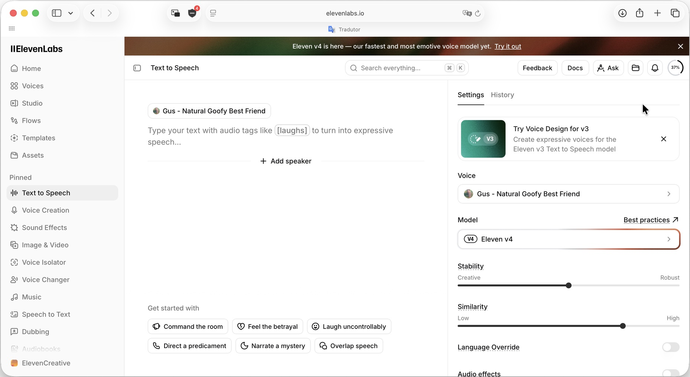
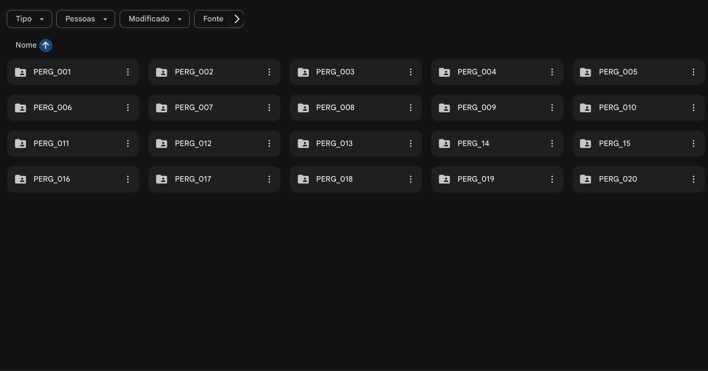

# hi, this is voiceovers in mass

bulk text-to-speech for game dialogue — and for any spreadsheet full of lines.
paste the sheet, generate every line in every language through elevenlabs, listen, approve the best take, and get everything back as `<ID>/<line>.mp3`, zipped or synced to a google drive folder.



## why

a game has more voice lines than it looks like: npcs, narration, tutorials, the instruction of every level. put them in a sheet — one row per line, one column per language — and each cell still needs a voice.

doing it by hand, every cell is the same six steps: paste the line into elevenlabs, generate, listen, download, rename the file after the line, upload it to the right drive folder.



128 lines × 4 languages is 512 audio files, so 3,072 of those steps — without typing a single folder name wrong. (look at `PERG_14` and `PERG_15` below.)



this app turns the sheet into the script: paste once, generate everything, approve, done.

## what it does

- imports `.xlsx`, `.csv`, `.ods` or cells pasted straight from google sheets, and finds the id column and the language columns from the header (`Português (PT)`, `Inglês (EN)`…)
- generates 2+ takes per line in parallel, within your elevenlabs plan's concurrency limit
- a review grid with a real waveform player per take: play, scrub, approve 👍, discard 👎, or ask for **+1 take**, which jumps the queue
- bulk selection (shift-click, "from here down", id ranges) and bulk approve — first or last take of each line — with undo
- the credit cost of a batch before you click, measured from what your account was actually charged
- a floating queue that never blocks the review: pause, resume, cancel, retry, and it pauses itself on errors that would fail every request (bad key, no credits, a voice your plan can't use)
- every take is kept in storage, approved ones export as a zip or mirror to a google drive folder of your choice
- accounts: each user sees only their own projects, takes and audio
- a landing page and a small blog, with the actual audio the app generated

## what a sheet looks like

| ID do Áudio | Personagem | Português (PT) | Inglês (EN) | Espanhol (ES) |
| --- | --- | --- | --- | --- |
| FALA_001 | Ferreiro | Bem-vindo à vila, viajante! | Welcome to the village, traveler! | ¡Bienvenido a la aldea, viajero! |
| FALA_002 | Guarda | Cuidado, a ponte está quebrada. | Careful, the bridge is broken. | Cuidado, el puente está roto. |

- a column is a language when its header ends with a code in parentheses. the code is what gets sent as `language_code`
- the id column becomes the folder name. the importer guesses it (a header with "id", "áudio" or "cód", or the first column with unique values) and you can change any column's role before creating the project
- other columns (character, scene, level) are kept for the review screen and never sent to the voice
- an empty cell means that line doesn't exist in that language — it is skipped, no credits spent
- google sheets copies its empty rows and columns along with your data; those are dropped on paste

what comes out:

```
Meu jogo/
  FALA_001/
    Bem-vindo à vila, viajante!.mp3
    Welcome to the village, traveler!.mp3
    ¡Bienvenido a la aldea, viajero!.mp3
  FALA_002/
    …
```

when two languages share the exact same text in a row, the language code is appended so nothing gets overwritten.

## the review loop

1. **gerar pendentes** queues N takes (2 by default) for every line that has no audio yet
2. listen. approve one take per line and language; discarding every take sends the line back to "sem áudio" for the next round
3. **+1 take** on a single line goes to the front of the queue, so it doesn't wait behind a 500-item batch
4. select a range and use **aprovar ▾** to approve in bulk — undo is right there for 10 seconds
5. **baixar zip**, or let the drive sync do it

selection tricks: shift-click selects a range, "daqui para baixo" selects that id and everything below, "intervalo" takes `PERG_010` → `PERG_050`, esc clears. in the language chips, click toggles a language and double-click keeps only that one.

## what it costs

elevenlabs bills per character sent, so a batch is

```
credits = characters × languages × takes × credits per character
```

the per-character rate isn't guessed: every take stores the `character-cost` the api returned, and the estimate uses the real rate for that model + voice (library voices can have a multiplier). with no history yet it falls back to 1 for most models and 0.5 for flash/turbo. on a real project — 128 lines, 4 languages, 2 takes, eleven v4 — that came to 21,090 credits.

prices, plans and the details are in [docs/elevenlabs-api-precos.md](docs/elevenlabs-api-precos.md).

## voices and plans

- new projects start on **eleven v4**, stability 0.5, similarity 0.75, mp3 44.1 khz 128 kbps
- voice library voices (like "Gus - Natural Goofy Best Friend") don't work through the api on the free plan. on free, new projects start with the premade **Will - Relaxed Optimist** instead; on paid plans, with gus
- even on a paid plan, a library voice has to be in **my voices** before the api can use it. the voice picker has a **voice library** tab with an **adicionar** button that does it for you (one of your plan's voice slots)

## google drive

each project can mirror its approved takes into a drive folder you pick by link:

- approving uploads `<folder>/<ID>/<line>.mp3`, creating the id folder if needed
- approving a different take replaces the file in place — same file id, so shared links keep working
- un-approving moves the file to the drive trash (recoverable for 30 days)
- it all runs in the background and reconciles, so a failed upload or a file deleted by hand is fixed on the next pass
- **tornar pública** sets "anyone with the link can view" on the folder

## run it yourself

```bash
git clone https://github.com/joaodellarmelina/voiceovers-in-mass.git
cd voiceovers-in-mass
pnpm install
cp .env.example .env.local
pnpm dev
```

then fill `.env.local`:

| variable | what for |
| --- | --- |
| `ELEVENLABS_API_KEY` | text to speech, voices (read), models (read), user (read) |
| `NEXT_PUBLIC_SUPABASE_URL`, `NEXT_PUBLIC_SUPABASE_PUBLISHABLE_KEY` | auth, database, storage |
| `SUPABASE_SECRET_KEY` | server only: the background drive sync |
| `AUTH_ALLOWED_EMAILS` | optional. everyone who signs in spends the same elevenlabs credits, so you probably want this |
| `GOOGLE_CLIENT_ID`, `GOOGLE_CLIENT_SECRET` | optional, for drive sync |
| `NEXT_PUBLIC_SITE_URL` | your domain, for canonical urls, sitemap and open graph |

### supabase

1. run the files in `supabase/migrations/` in order (sql editor, the cli, or the supabase mcp). they create the tables with row level security, the private `takes` bucket and its policies
2. authentication → url configuration: site url `http://localhost:3000`, redirect url `http://localhost:3000/**`
3. sign up at `/login`

projects created before accounts existed (in `data/projects/`) show up on the dashboard with an **importar para minha conta** button.

### google drive (optional)

1. in the google cloud console, enable the **google drive api**
2. oauth consent screen: external. while it's in "testing", google expires the connection every 7 days — publish it to stop that (for your own use, accept the "unverified app" warning)
3. credentials → oauth client id → web application, redirect uri `http://localhost:3000/api/drive/callback`
4. put the client id and secret in `.env.local`, restart, then **drive → conectar conta google** in a project

that's it — you're up and running.

## how it works

```
app/page.tsx                    landing page (a story built from a real project)
app/blog/                       blog, with per-post metadata and json-ld
app/dashboard/                  the app: import, project list, review
app/api/projects/[id]/generate  one take = one elevenlabs request
app/api/projects/[id]/approvals bulk approve / undo in one request
app/api/drive/                  google oauth for drive
proxy.ts                        refreshes the supabase session, guards /dashboard and /api
lib/store.ts                    data access over supabase
lib/drive-sync.ts               reconciles approvals with the drive folder
lib/sheet.ts                    sheet parsing (sheetjs), shared by the app and the landing
components/generation-queue.ts  the browser-side queue
components/player.tsx           one shared audio engine + waveform tracks
supabase/migrations/            schema, rls, storage policies
```

a few things worth knowing if you're poking around:

- **the queue lives in the browser, one request per take.** each job is one `POST /generate`, which is one elevenlabs call. that keeps the server stateless, makes progress live, and lets you cancel, retry or reprioritize a single line. concurrency is read on every pump, so changing it mid-run takes effect right away.
- **errors that would fail every request pause the queue.** a bad key, no credits or a voice the plan can't use would otherwise burn through the whole batch one failure at a time. 429s are retried with backoff by the official sdk (`maxRetries: 4`).
- **every take keeps its seed and request id.** a random seed per take is what makes variations differ; storing it makes a good take reproducible.
- **rls on every table, and every query also filters by `user_id`.** the background drive sync has no user session and runs with the secret key, so it can't rely on rls — the explicit filter keeps it from ever touching another user's rows. child tables check that the parent project is yours before an insert.
- **drive tokens are server-only by construction.** `drive_connections` has rls on and no grants for `anon`/`authenticated`, so nothing in the browser can read it, not even your own row.
- **tables aren't exposed to the data api by default anymore** (supabase changed this in 2026), so the migration grants them explicitly.
- **postgrest returns at most 1,000 rows per request**, so project rows and takes are fetched in pages.
- **the server checks the user with `getClaims()`**, which verifies the jwt signature, never `getSession()`, which trusts the cookie.
- **a service account can't do the drive part.** it has no storage quota in a personal "my drive", so uploads into your folder would fail — hence oauth with your own account, and the full drive scope, the only one that can write into a folder you pick by link.
- **one `<audio>` element for the whole page.** starting a take stops the previous one. waveforms are decoded once per take, lazily, when the card scrolls into view; the playhead is driven by `requestAnimationFrame`, not `timeupdate`.
- **the landing page never calls elevenlabs.** its review cards are the app's real components over files in `public/landing/audio/` — takes the app actually generated.
- next.js 16: middleware is now `proxy.ts`, route params are promises, and `next typegen` generates the `PageProps` / `RouteContext` types.
